# `:feature:messaging`

## Overview
The `:feature:messaging` module handles the core communication features of the app, including text messages, direct messages (DMs), and channel-based chat.

## Key Components

### 1. `ContactsViewModel` and `AdaptiveContactsScreen`
The conversation list (`ui/contact/`), shown with the open conversation in a Material 3 Adaptive list/detail layout.

### 2. `MessageViewModel`
Manages the state of the chat screen: paged loading of messages from the database, sending, replies, reactions, resend and delete, per-conversation drafts, in-conversation search, unread tracking, and on-demand translation.

### 3. Quick Chat
`QuickChatScreen` and `QuickChatViewModel` manage the quick chat actions, the saved one-tap messages. `MessageViewModel.toggleShowQuickChat()` shows them as a row on the message screen.

### 4. Homoglyph substitution (payload-size optimization)
Uses `HomoglyphCharacterStringTransformer` (from `:core:common`) to optionally replace national-alphabet characters with visually identical Latin homoglyphs (for example Cyrillic "А" → Latin "A") on outgoing text. `SendMessageUseCase` (`:core:repository`) applies it when the `HomoglyphPrefs` preference is on, and the message input counts bytes against the transformed text. This is a byte-size optimization: such characters encode smaller in UTF-8, fitting roughly 140-145 characters per message instead of ~115-120. It is not a security or anti-phishing feature.

### 5. Translation
`MessageTranslationService` translates a received message on request. The `google` flavor binds ML Kit (`MlKitMessageTranslator` in `:androidApp`); F-Droid and Desktop bind `NoOpMessageTranslator`.

## Navigation

`contactsGraph()` (`navigation/ContactsNavigation.kt`) registers `ContactsRoute.Contacts` as the list pane, `ContactsRoute.Messages` as the detail pane, and `ContactsRoute.Share` and `ContactsRoute.QuickChat` as extra panes.

## Features
- **Channel Chat**: Group communication on public or private channels.
- **Direct Messaging**: One-on-one encrypted communication between nodes.
- **Photo and video sharing**: Pick existing media or capture a photo/video with the Android camera directly from the composer.
- **Fullscreen photos**: Pinch to zoom (1-5x), pan, and keep the viewer open when rotating the phone.
- **Message Reactions**: Support for reacting to messages with emojis.
- **Markdown formatting**: `FormattingToolbar` inserts or toggles bold, italic, strikethrough, code and link markup.
- **Delivery Status**: `MessageStatusIcon` shows each `MessageStatus`: queued, en route, delivered (ACK), error (NAK), and the SF++ chain routing and confirmed states.
- **Background send** (Android): `WorkManagerMessageQueue` hands queued messages to WorkManager for transmission.

### VIP Brotli transport

Broadcast text, replies, reactions and media links on a channel named exactly `VIP` use Brotli quality 11.
The radio payload is UTF-8 `VIPB1:` followed by standard Base64 of the Brotli stream (encoder window 16).
Outgoing history stays readable; incoming packets, including store-and-forward history, are decoded before
filtering, persistence and notifications, so the existing image/video/audio URL previews work unchanged.
New plain or malformed VIP messages are dropped with a diagnostic log; existing history is not rewritten.
Other channel names and direct messages keep their existing format.

This is compression, **not encryption**. The official app does not decode this custom format, but anyone
with access to the payload can decompress it. Uploaded files remain unchanged on the temporary host.
The full encoded protobuf must fit one radio packet; oversized messages fail explicitly, without truncation,
fragmentation or plaintext fallback. Decoded text is limited to 4096 UTF-8 bytes.

## Testing

`./gradlew :feature:messaging:allTests`. There are no Android host tests (`commonTest` holds Compose UI tests), so this runs the suite on JVM.

## Dependency Graph

```mermaid
graph TB
  :feature:messaging[messaging]:::kmp-feature
  :feature:messaging -.-> :core:common
  :feature:messaging -.-> :core:model
  :feature:messaging -.-> :core:navigation
  :feature:messaging -.-> :core:repository
  :feature:messaging -.-> :core:resources
  :feature:messaging -.-> :core:ui
  :feature:messaging -.-> :core:testing

classDef android-application fill:#CAFFBF,stroke:#000,stroke-width:2px,color:#000;
classDef android-application-compose fill:#CAFFBF,stroke:#000,stroke-width:2px,color:#000;
classDef compose-desktop-application fill:#CAFFBF,stroke:#000,stroke-width:2px,color:#000;
classDef android-feature fill:#FFD6A5,stroke:#000,stroke-width:2px,color:#000;
classDef android-library fill:#9BF6FF,stroke:#000,stroke-width:2px,color:#000;
classDef android-library-compose fill:#9BF6FF,stroke:#000,stroke-width:2px,color:#000;
classDef android-test fill:#A0C4FF,stroke:#000,stroke-width:2px,color:#000;
classDef jvm-library fill:#BDB2FF,stroke:#000,stroke-width:2px,color:#000;
classDef kmp-feature fill:#FFD6A5,stroke:#000,stroke-width:2px,color:#000;
classDef kmp-library-compose fill:#FFC1CC,stroke:#000,stroke-width:2px,color:#000;
classDef kmp-library fill:#FFC1CC,stroke:#000,stroke-width:2px,color:#000;
classDef unknown fill:#FFADAD,stroke:#000,stroke-width:2px,color:#000;

```

<!--region graph-->

<!--endregion-->
