# `:feature:settings`

## Overview
The `:feature:settings` module manages all application and device-side configurations. This includes user preferences, channel configuration, and advanced node settings.

## Key Components

### 1. `SettingsScreen` and `DesktopSettingsScreen`
The main entry point for application-wide settings: `SettingsScreen` in `androidMain`, `DesktopSettingsScreen` in `jvmMain`. Both carry the settings search field (`search/`, `SettingsSearchViewModel`), which jumps to a matching setting.

### 2. `RadioConfigViewModel`
Handles reading and writing configuration to the Meshtastic device over the connected transport (BLE, USB, or TCP). The config and module screens are listed in `navigation/ConfigRoute.kt` and `navigation/ModuleRoute.kt`, with one `*ConfigItemList` or `*ConfigScreen` per section under `radio/component/`.

### 3. `AboutScreen`
Displays what Meshtastic is, a "Need Hardware?" row, version information, and project links.

### 4. `AcknowledgementsScreen`
Displays the open-source libraries the app is built on, with their licenses.

## Validation Reference
- See [settings-validation.md](settings-validation.md) for detailed radio/module settings validation rules used by this module.

## Features
- **Android support email**: The update row displays the full installed version. “Report an app error” opens an email draft to `msabanda@gmail.com` with the version and a localized reproduction template. No logs, channel keys or chat content are attached, and sending requires user action in their email app. If no email app is available, an explicit notice includes the support address.
- **Update indication**: An available, actionable update softly pulses green. The download bar never pulses: it stays determinate during status queries and animates between the reported progress values. Unknown-source installation permission is checked against Android's current grant, not requested on every update.
- **Android APK updates**: Settings checks `mvisions/Meshtastic-Android` GitHub releases, including prereleases. Tapping Update app asks for confirmation with the destination version. After confirmation, DownloadManager downloads the APK to app-private storage; verification checks size, SHA-256, package, newer version and signing certificate. While this screen is in the foreground, a verified download automatically opens a system APK installer without a third-party app chooser. Granting Android's install-from-this-source permission and returning resumes installation automatically; denying it or cancelling installation requires an explicit retry. Android's installation confirmation and Play Protect cannot be bypassed. Configuration changes preserve the confirmed download; an unconfirmed restored download never auto-installs. Installation is only reported successful after reading the actual installed version. Published tags must follow `media-links-test-N[.N...]`, installed version names `2.8.4-media-partN[.N...]`, and uploaded assets must be named `Meshtastic-media-arm64.apk` (ARM64 phones) and `Meshtastic-media-universal.apk` (other architectures). Numeric project versions must increase for every release. Network, verification and installer failures are displayed explicitly.
- **Channel Configuration**: Manage encryption keys, channel names, and LoRa frequency settings.
- **Node Database Management**: `CleanNodeDatabaseScreen` removes nodes not heard for a chosen number of days, from the app's database and from the connected node's.
- **Database backup and restore**: `DatabaseBackupViewModel` backs up the app database for the connected device and stages a restore that applies on the next launch.
- **App Preferences**: Theme selection, display units (follow the system, metric, or imperial), and notification settings.
- **Lockdown mode** (`lockdown/`): the passphrase-protected lockdown toggle on the security settings screen.
- **Debug panel** (`debugging/`): the mesh log viewer, with filters, search and export.
- **Device Links** (`DeviceLinkDirectoryScreen`): every imported msh.to link, sorted by short code.

## Testing

`./gradlew :feature:settings:allTests`. There are no Android host tests (`commonTest` holds Compose UI tests), so this runs the suite on JVM.

## Dependency Graph

```mermaid
graph TB
  :feature:settings[settings]:::kmp-feature
  :feature:settings -.-> :core:common
  :feature:settings -.-> :core:database
  :feature:settings -.-> :core:domain
  :feature:settings -.-> :core:model
  :feature:settings -.-> :core:navigation
  :feature:settings -.-> :core:network
  :feature:settings -.-> :core:repository
  :feature:settings -.-> :core:resources
  :feature:settings -.-> :core:ui
  :feature:settings -.-> :core:di
  :feature:settings -.-> :core:takserver
  :feature:settings -.-> :core:testing

classDef android-application fill:#CAFFBF,stroke:#000,stroke-width:2px,color:#000;
classDef android-application-compose fill:#CAFFBF,stroke:#000,stroke-width:2px,color:#000;
classDef compose-desktop-application fill:#CAFFBF,stroke:#000,stroke-width:2px,color:#000;
classDef android-feature fill:#FFD6A5,stroke:#000,stroke-width:2px,color:#000;
classDef android-library fill:#9BF6FF,stroke:#000,stroke-width:2px,color:#000;
classDef android-library-compose fill:#9BF6FF,stroke:#000,stroke-width:2px,color:#000;
classDef android-test fill:#A0C4FF,stroke:#000,stroke-width:2px,color:#000;
classDef jvm-library fill:#BDB2FF,stroke:#000,stroke-width:2px,color:#000;
classDef kmp-feature fill:#FFD6A5,stroke:#000,stroke-width:2px,color:#000;
classDef kmp-library-compose fill:#FFC1CC,stroke:#000,stroke-width:2px,color:#000;
classDef kmp-library fill:#FFC1CC,stroke:#000,stroke-width:2px,color:#000;
classDef unknown fill:#FFADAD,stroke:#000,stroke-width:2px,color:#000;

```

<!--region graph-->

<!--endregion-->
